# Art Skill

An art-direction skill for Codex and other AI agents, with reusable styles and slash-command workflows for images and visual asset packs.

**Status:** usable skill with tested offline planning, installation, and 18 bundled recipes and 36 visually reviewed photo-to-style examples. Cross-host slash-menu discovery, a same-style multi-asset pack and cutout transparency still need smoke tests.

## Twelve new styles

**12 new generated examples**, one per added recipe. These use the four original photographs shown below. Click any image for its original reference, prompt, recipe and review notes.

| Watercolor Wash | Gouache Poster |
| --- | --- |
| [](examples/expanded-styles/watercolor-wash/README.md) | [](examples/expanded-styles/gouache-poster/README.md) |

| Linocut | Risograph |
| --- | --- |
| [](examples/expanded-styles/linocut/README.md) | [](examples/expanded-styles/risograph/README.md) |

| Stained Glass | Cyanotype |
| --- | --- |
| [](examples/expanded-styles/stained-glass/README.md) | [](examples/expanded-styles/cyanotype/README.md) |

| Clay Diorama | Felt Collage |
| --- | --- |
| [](examples/expanded-styles/clay-diorama/README.md) | [](examples/expanded-styles/felt-collage/README.md) |

| Embroidery | Ink Wash |
| --- | --- |
| [](examples/expanded-styles/embroidery/README.md) | [](examples/expanded-styles/ink-wash/README.md) |

| Geometric Facets | Ceramic Mosaic |
| --- | --- |
| [](examples/expanded-styles/geometric-facets/README.md) | [](examples/expanded-styles/ceramic-mosaic/README.md) |

[All twelve examples and recorded results](examples/expanded-styles/README.md) · [All 18 selectable styles](skills/art-skill/references/styles.md)

Try `$art-skill remix this photo in watercolor-wash`, or choose any ID in the catalog. Hosts with a native skill command use `/art-skill remix …`; the host invocation rules below still apply.

## Four photos × six styles

**24 generated reference images.** Each supplied photo has its own six-style gallery, using that original directly for every version. Click any artwork to open its prompt, recipe and recorded result.

### Building and rainbow

Original reference: [building-rainbow.jpg](examples/photo-variants/originals/building-rainbow.jpg).


| ASCII & Pixels | Sketch & Scribble |
| --- | --- |
| [](examples/photo-variants/building-rainbow/ascii-pixels/README.md) | [](examples/photo-variants/building-rainbow/sketch-scribble/README.md) |

| Digital Impressionism | Lo-fi Film Imagery |
| --- | --- |
| [](examples/photo-variants/building-rainbow/digital-impressionism/README.md) | [](examples/photo-variants/building-rainbow/lofi-film/README.md) |

| Generative Flow | Off-white Minimalism |
| --- | --- |
| [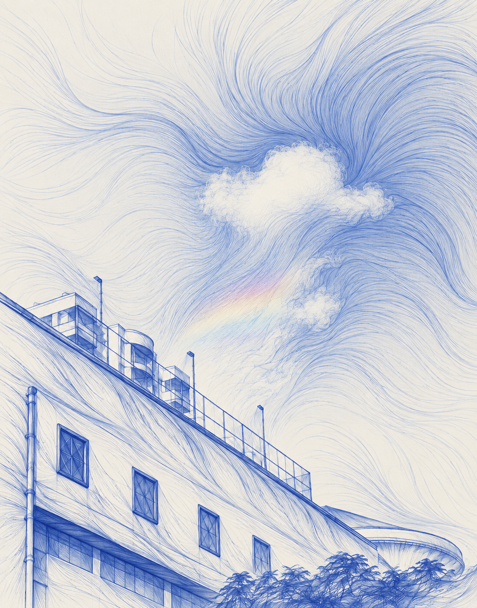](examples/photo-variants/building-rainbow/generative-flow/README.md) | [](examples/photo-variants/building-rainbow/off-white/README.md) |

### Hillside garden

Original reference: [hillside-garden.jpg](examples/photo-variants/originals/hillside-garden.jpg).


| ASCII & Pixels | Sketch & Scribble |
| --- | --- |
| [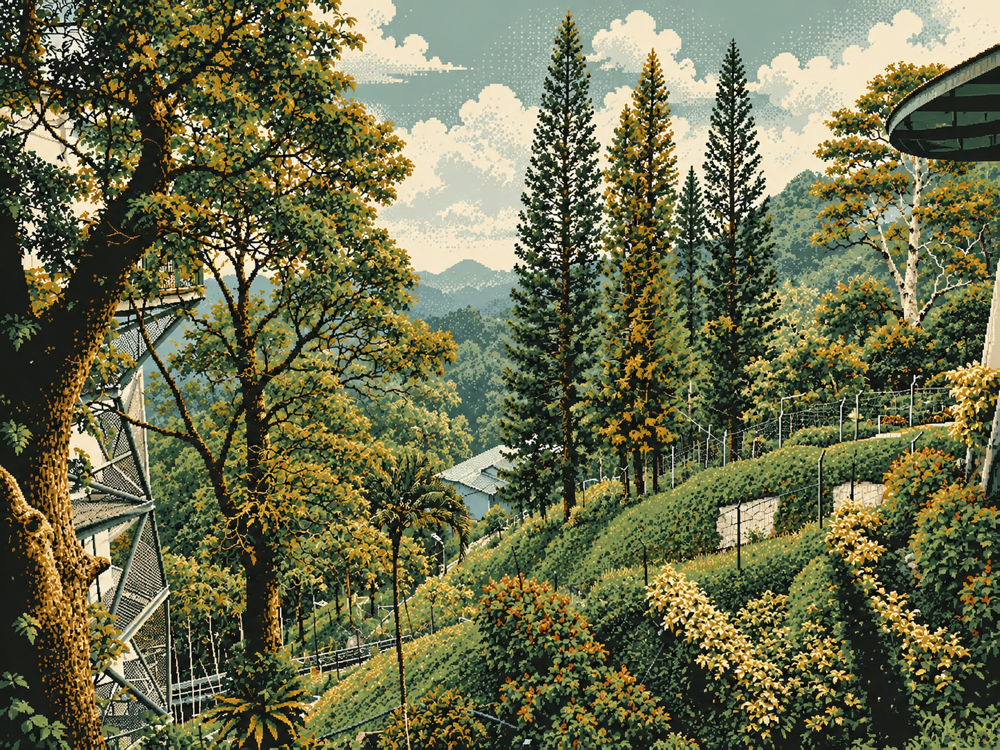](examples/photo-variants/hillside-garden/ascii-pixels/README.md) | [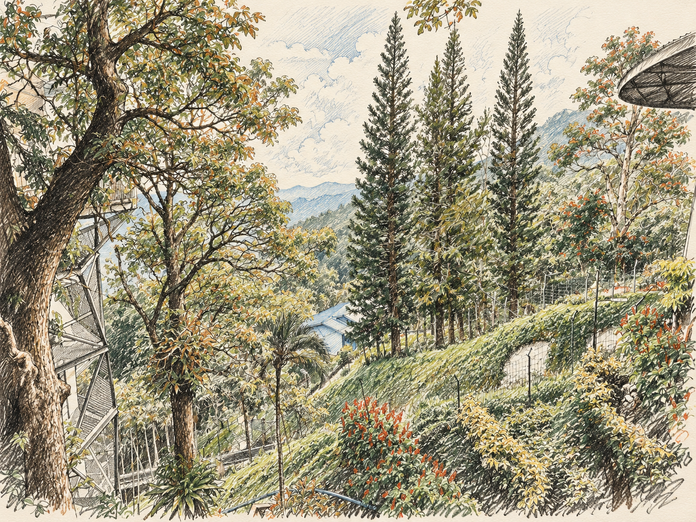](examples/photo-variants/hillside-garden/sketch-scribble/README.md) |

| Digital Impressionism | Lo-fi Film Imagery |
| --- | --- |
| [](examples/photo-variants/hillside-garden/digital-impressionism/README.md) | [](examples/photo-variants/hillside-garden/lofi-film/README.md) |

| Generative Flow | Off-white Minimalism |
| --- | --- |
| [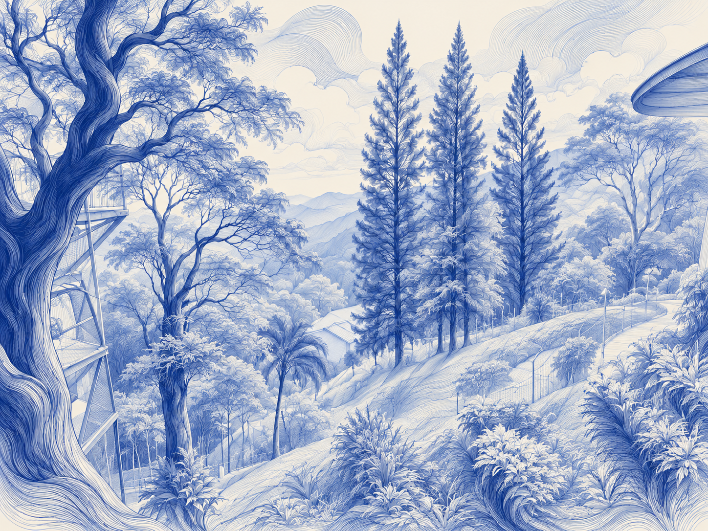](examples/photo-variants/hillside-garden/generative-flow/README.md) | [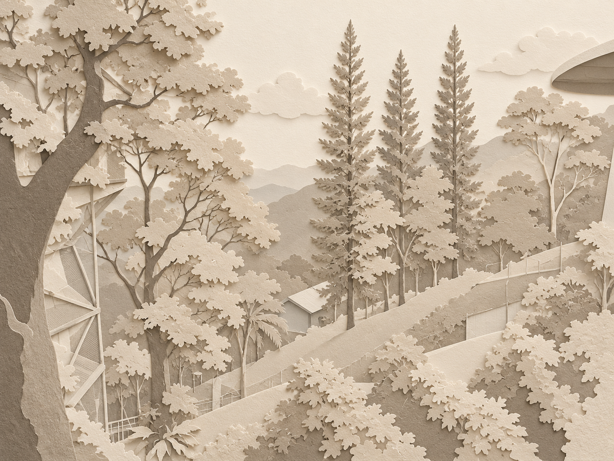](examples/photo-variants/hillside-garden/off-white/README.md) |

### Sunset bay

Original reference: [sunset-bay.jpg](examples/photo-variants/originals/sunset-bay.jpg).


| ASCII & Pixels | Sketch & Scribble |
| --- | --- |
| [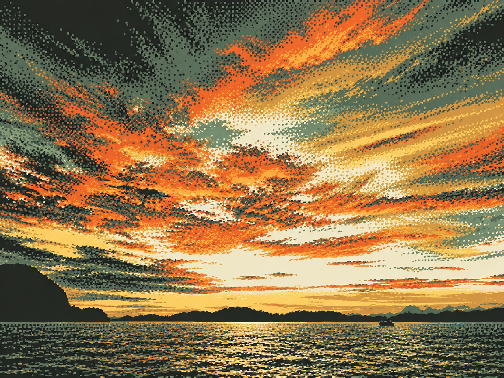](examples/photo-variants/sunset-bay/ascii-pixels/README.md) | [](examples/photo-variants/sunset-bay/sketch-scribble/README.md) |

| Digital Impressionism | Lo-fi Film Imagery |
| --- | --- |
| [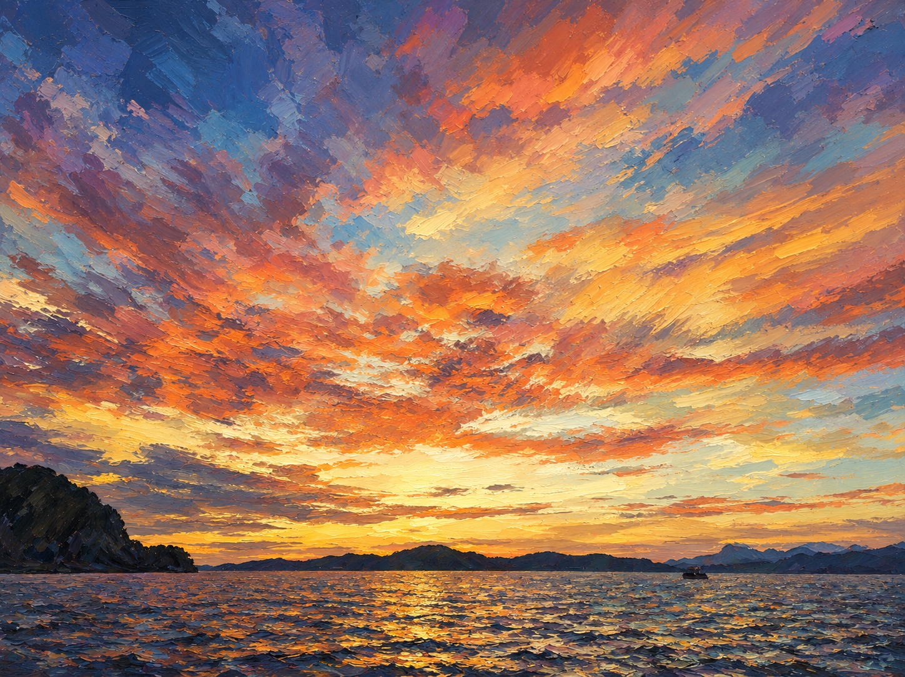](examples/photo-variants/sunset-bay/digital-impressionism/README.md) | [](examples/photo-variants/sunset-bay/lofi-film/README.md) |

| Generative Flow | Off-white Minimalism |
| --- | --- |
| [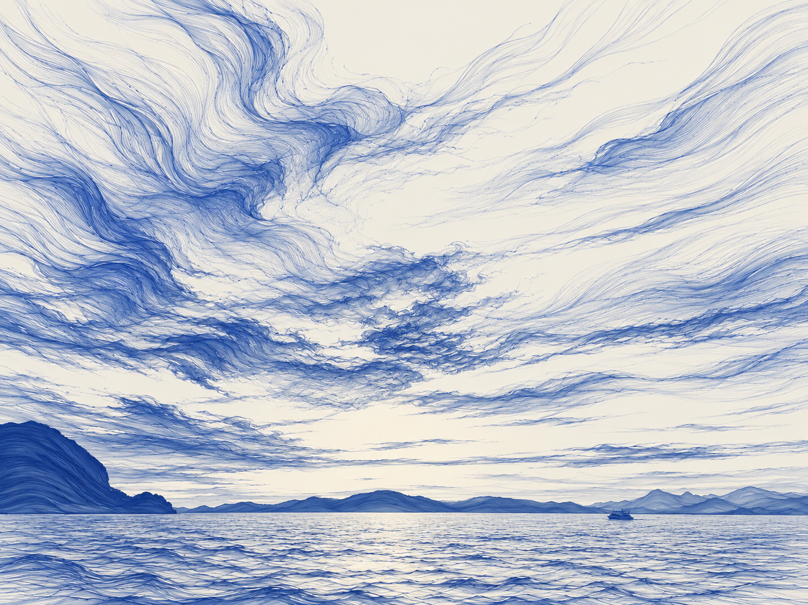](examples/photo-variants/sunset-bay/generative-flow/README.md) | [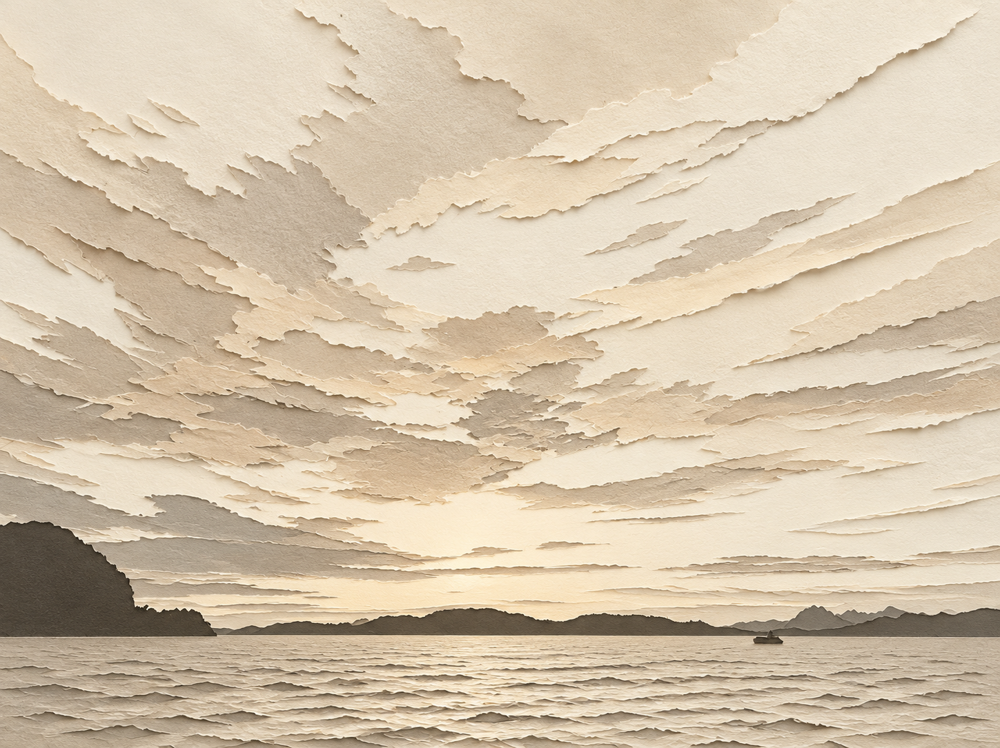](examples/photo-variants/sunset-bay/off-white/README.md) |

### Towering cumulus

Original reference: [cumulus-clouds.jpg](examples/photo-variants/originals/cumulus-clouds.jpg).


| ASCII & Pixels | Sketch & Scribble |
| --- | --- |
| [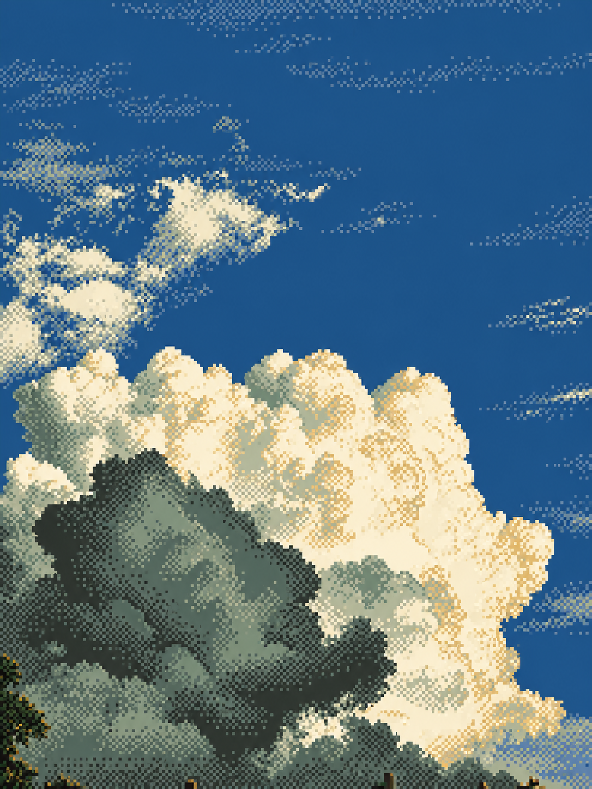](examples/photo-variants/cumulus-clouds/ascii-pixels/README.md) | [](examples/photo-variants/cumulus-clouds/sketch-scribble/README.md) |

| Digital Impressionism | Lo-fi Film Imagery |
| --- | --- |
| [](examples/photo-variants/cumulus-clouds/digital-impressionism/README.md) | [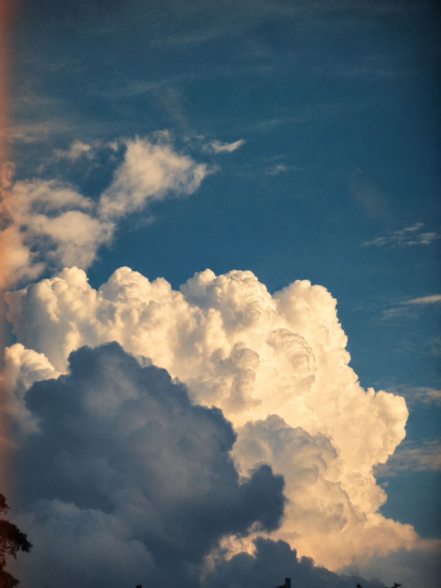](examples/photo-variants/cumulus-clouds/lofi-film/README.md) |

| Generative Flow | Off-white Minimalism |
| --- | --- |
| [](examples/photo-variants/cumulus-clouds/generative-flow/README.md) | [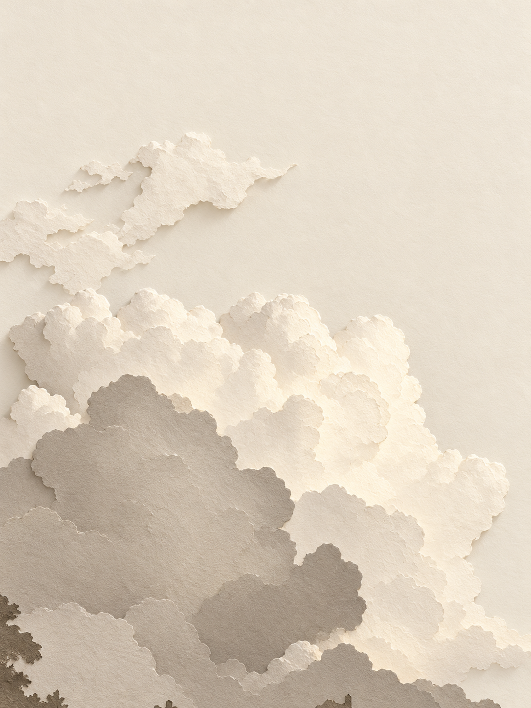](examples/photo-variants/cumulus-clouds/off-white/README.md) |

[All photo sets and source notes](examples/photo-variants/README.md) · [Recorded generation index](examples/photo-variants/manifest.json)

Recorded run: 24 built-in image calls, 24 native PNGs, zero repairs. Actual dimensions and review notes are recorded per image; model identity and monetary cost were not exposed. Each gallery now includes its unchanged original reference under a descriptive filename.

## Start in a project

Requires Python 3.10+ for the helpers. They use only the standard library.

From this repository, install the full skill into an existing project:

```text
python tools/install.py --project /path/to/project --agent codex --dry-run
python tools/install.py --project /path/to/project --agent codex
```

On Windows, quote a project path with spaces. Replace `/path/to/project` with the actual existing folder. The installer refuses an existing `art-skill` skill rather than replacing it.

For another host, use `--agent claude` or `--agent cursor`; repeat `--agent` to install for multiple hosts.

## Invoke the skill

- Codex: `$art-skill styles` or CLI/IDE `/skills` then select it. In the desktop app, enabled skills appear in the `/` menu; verify the exact displayed alias locally.
- Claude Code / Cursor: `/art-skill styles`.
- Natural language: “Use Art Skill to make a digital impressionist image pack for a rainy reading room.”

The actions are `help`, `styles`, `brief`, `make`, `pack`, `remix`, `inspect`, and `export`. They are arguments to the skill, not separate global commands.

Official invocation sources: [OpenAI skills](https://learn.chatgpt.com/docs/build-skills), [OpenAI desktop slash menu](https://learn.chatgpt.com/docs/reference/slash-commands), [Claude Code skills](https://code.claude.com/docs/en/skills), [Cursor skills](https://cursor.com/help/customization/skills).

Skill installation and image-tool availability are separate. Codex uses its available built-in image workflow. Claude Code and Cursor need a separately configured image backend. Without one, the skill produces prompts and a `requires_backend` plan. This repository does not bundle an API client or make network requests.

## Preview the example without generating images

```text
python skills/art-skill/scripts/plan_pack.py examples/rainy-reading-room.brief.json
python skills/art-skill/scripts/plan_pack.py examples/rainy-reading-room.brief.json --out output/plan.json
python -m unittest discover -s tests -v
```

The sample requests four assets: landscape anchor, square cover, portrait composition and transparent mug/book vignette. Its six-call cap includes up to two repairs. Every derivative references the same anchor. The planner refuses unsupported combinations such as transparent JPEG and never overwrites an existing plan.

## Recipes

| ID | Direction | Practical limit |
| --- | --- | --- |
| `ascii-pixels` | Pixel blocks and glyph-like stippling | Raster aesthetic; no exact ASCII/grid guarantee |
| `sketch-scribble` | Gestural pencil/ink on paper | Strokes can change during edits |
| `digital-impressionism` | Broken-color strokes and warm/cool light | Visual consistency needs review |
| `lofi-film` | Soft focus, restrained grain and light leaks | Aesthetic, not calibrated film simulation |
| `generative-flow` | Layered contours and filaments | Raster art, not executable seeded code |
| `off-white` | Warm neutral still life and empty space | Artwork, not a functional website |

| `watercolor-wash` | Watercolor Wash | Paper and pigment behavior are visual approximations, not a physical watercolor simulation. |
| `gouache-poster` | Gouache Poster | A poster aesthetic does not supply print layouts or guarantee exact typography. |
| `linocut` | Linocut | Raster art only; no cutting template, separated plates or carve-ready geometry is supplied. |
| `risograph` | Risograph | No actual spot-color separations, calibrated inks or press-ready print files are generated. |
| `stained-glass` | Stained Glass | No fabrication pattern, cut lines or structurally validated glazing design is supplied. |
| `cyanotype` | Cyanotype | This is an image aesthetic, not a real photographic exposure or calibrated cyanotype process. |
| `clay-diorama` | Clay Diorama | Raster visualization only; no 3D model, mesh, construction plan or physically accurate material is supplied. |
| `felt-collage` | Felt Collage | No fabric cutting template or stitch pattern is supplied. |
| `embroidery` | Embroidery | No machine embroidery file, thread specification or repeatable stitch geometry is generated. |
| `ink-wash` | Ink Wash | Wash edges and tonal detail may drift during edits; physical ink diffusion is not simulated. |
| `geometric-facets` | Geometric Facets | Raster illustration only; no vector paths or exact polygon topology is supplied. |
| `ceramic-mosaic` | Ceramic Mosaic | No tile schedule, fabrication pattern, seamless texture or exact tessellation is supplied. |

The recipes are original descriptions of broad visual traits. No presenter images, video collages, artist works or brand marks are included. The gallery includes four user-provided reference photographs and their generated artwork. Source names are descriptive; the supplied files and visible credits are preserved.

## More art ideas

The twelve additional directions are now bundled recipes with live examples: **watercolor wash, gouache poster, linocut, risograph, stained glass, cyanotype, clay diorama, felt collage, embroidery, ink wash, geometric facets, and ceramic mosaic**.

[See the added styles and four asset-pack workflow ideas](docs/art-ideas.md). The eighteen recipes are available now; the workflow ideas describe ways to use them. Same-style pack consistency still needs a separate smoke test.

## Repository map

```text
skills/art-skill/
  SKILL.md
  agents/openai.yaml
  assets/styles/                  18 JSON recipes
  scripts/plan_pack.py            offline planning
  references/                    commands, hosts, contracts, visual checks
examples/
  rainy-reading-room.brief.json
  rainy-reading-room.plan.json    actual planner output; no artwork
  photo-variants/                 four originals × six styles, prompts and manifests
    originals/                    unchanged photos with descriptive filenames
  expanded-styles/                twelve more recipes, one live example each
tools/install.py
tests/test_contracts.py
docs/research-evidence.json
docs/recipe-format.md
docs/art-ideas.md                  twelve added styles and four pack ideas
docs/validation.md
LICENSE
```

Keep one canonical skill under `skills/`; project copies are installation outputs. A later plugin or MCP adapter can distribute the workflow or supply tools without changing its pack contract.

MIT license covers this original starter's code and instructions. It does not establish rights in third-party references or future generated outputs.
