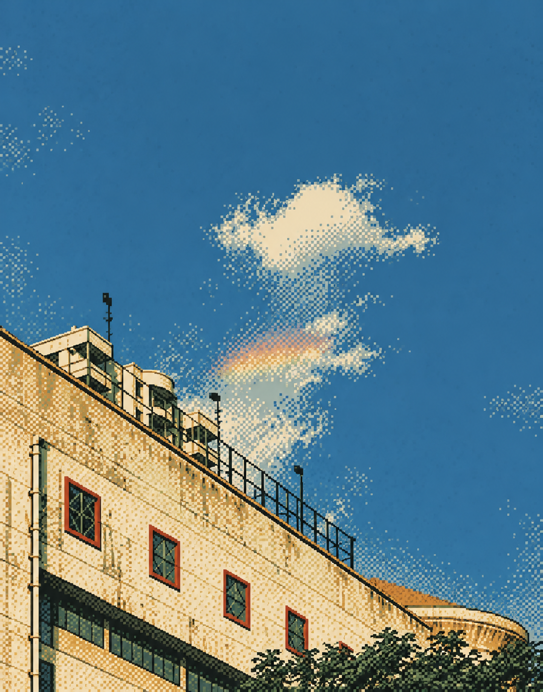

# Building and rainbow — ASCII & Pixels

Source: [building-rainbow.jpg](../../originals/building-rainbow.jpg). One independent style interpretation of that photograph.

Intentional pixel clusters and dot texture; the main subject silhouette remains readable. Upward viewpoint, diagonal facade, window rhythm, small cloud and rainbow motif remain recognizable.

Native PNG: 1112 × 1415. One built-in image call.

[Actual prompt](prompt.txt) · [Brief](brief.json) · [Plan](plan.json) · [Recipe](style.json) · [Recorded result](manifest.json)

Limitations: Broad composition is preserved; exact geometry, source colors and small details can be interpreted. The blue sky and soft rainbow motif retain more source color than the recipe palette. Does not produce valid ASCII text files. Does not guarantee a pixel-aligned grid.

[All six versions of this photo](../README.md)
