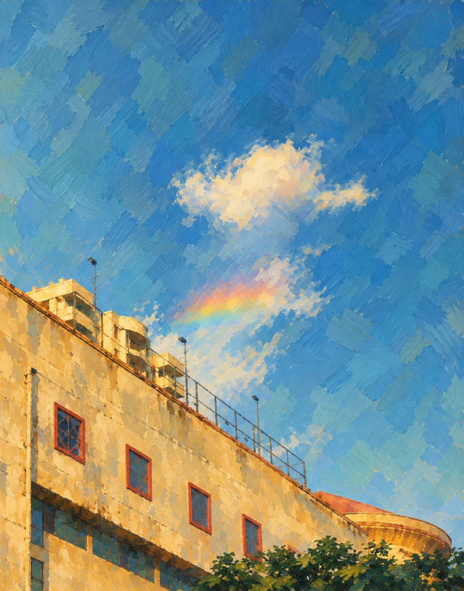

# Building and rainbow — Digital Impressionism

Source: `444444.jpg`. One independent style interpretation of that photograph.

Short layered broken-color brushwork replaces photographic detail while retaining the broad composition. Upward viewpoint, diagonal facade, window rhythm, small cloud and rainbow motif remain recognizable.

Native PNG: 1112 × 1415. One built-in image call.

[Actual prompt](prompt.txt) · [Brief](brief.json) · [Plan](plan.json) · [Recipe](style.json) · [Recorded result](manifest.json)

Limitations: Broad composition is preserved; exact geometry, source colors and small details can be interpreted. Palette and geometry require visual review across images.

[All six versions of this photo](../README.md)
