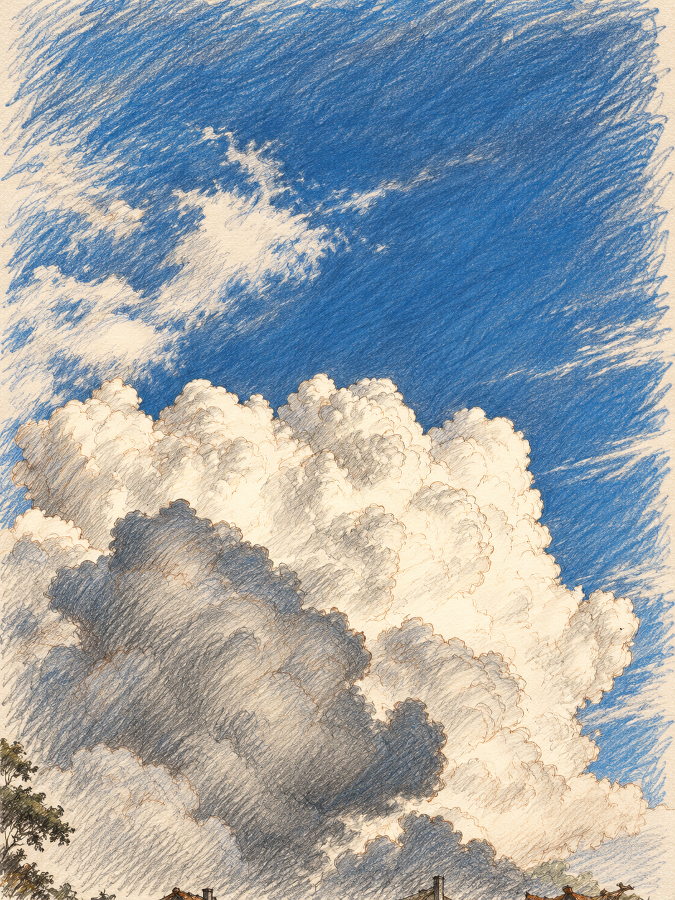

# Towering cumulus — Sketch & Scribble

Source: [cumulus-clouds.jpg](../../originals/cumulus-clouds.jpg). One independent style interpretation of that photograph.

Visible paper, varied pencil/ink lines and gestural hatching distinguish the drawing from the source photo. Upward viewpoint, broad cloud lobes and the bright/right versus shadowed/left pattern remain recognizable.

Native PNG: 1086 × 1448. One built-in image call.

[Actual prompt](prompt.txt) · [Brief](brief.json) · [Plan](plan.json) · [Recipe](style.json) · [Recorded result](manifest.json)

Limitations: Broad composition is preserved; exact geometry, source colors and small details can be interpreted. Blue sky hatching is extensive; cream paper remains visible between strokes. Stroke placement can drift during edits.

[All six versions of this photo](../README.md)
