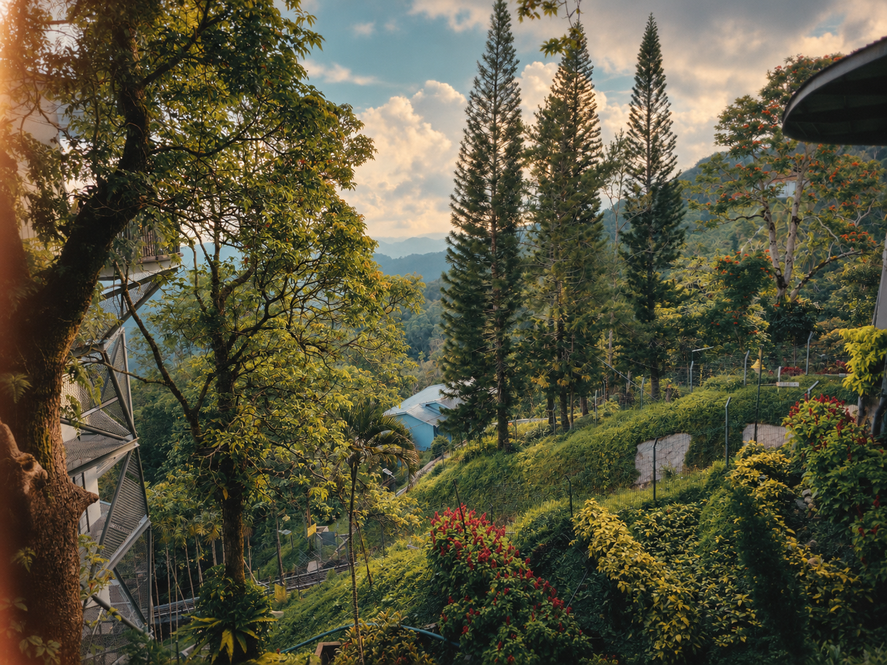

# Hillside garden — Lo-fi Film Imagery

Source: [hillside-garden.jpg](../../originals/hillside-garden.jpg). One independent style interpretation of that photograph.

Photographic-looking materials, restrained grain, gentle vignette and a subtle warm edge leak. Left trunk, conifer rhythm, slope, distant hills and path remain recognizable.

Native PNG: 1448 × 1086. One built-in image call.

[Actual prompt](prompt.txt) · [Brief](brief.json) · [Plan](plan.json) · [Recipe](style.json) · [Recorded result](manifest.json)

Limitations: Broad composition is preserved; exact geometry, source colors and small details can be interpreted. This is a visual aesthetic, not a calibrated film or camera simulation.

[All six versions of this photo](../README.md)
